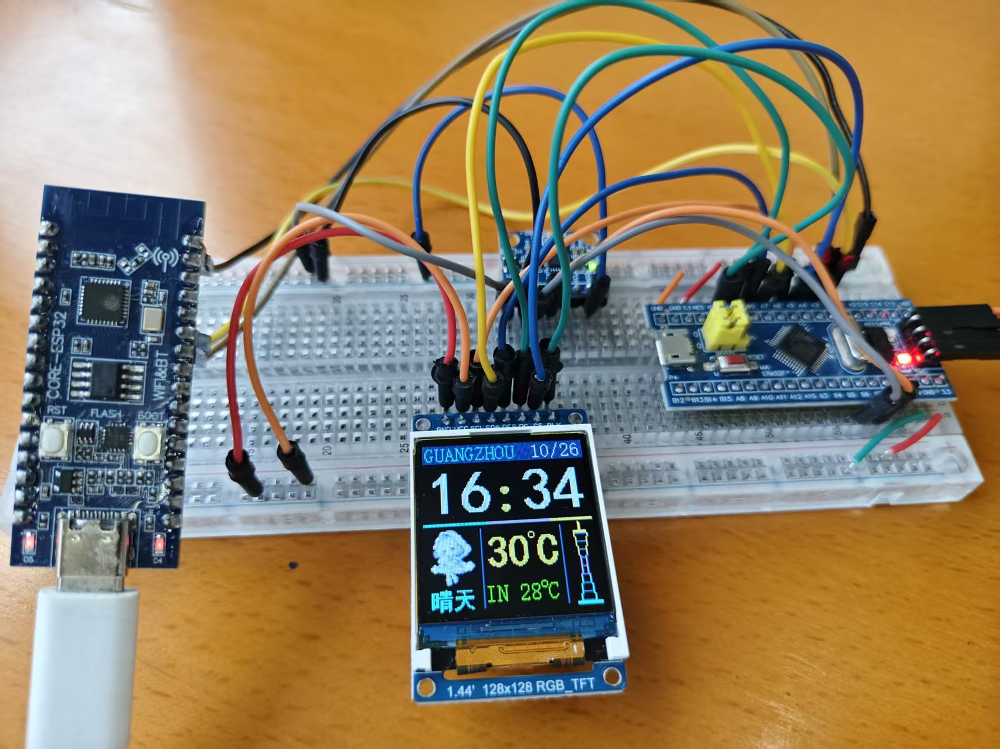
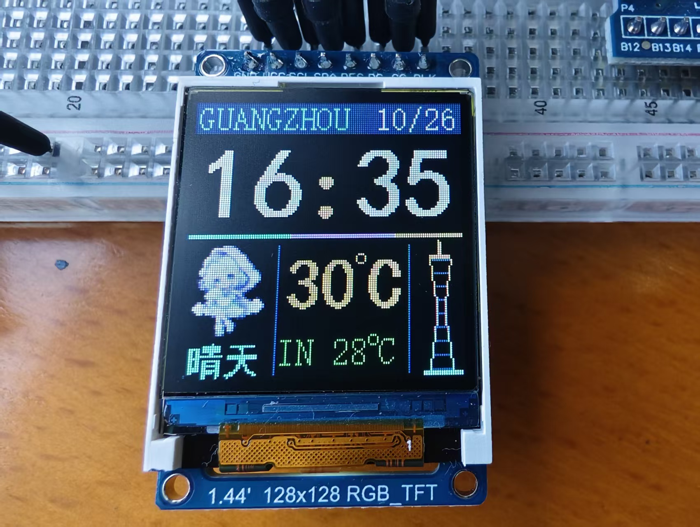

# 基于 FreeRTOS 的 STM32 联网天气时钟终端

这是一个基于 STM32F103C8T6 和 FreeRTOS 的联网天气时钟终端。STM32 通过 ESP32 AT 模块接入 Wi-Fi，使用 SNTP 校准片内 RTC，定期请求 Open-Meteo 天气数据，并在 1.44 英寸 ST7735 RGB TFT 上显示日期、时间、天气图标、网络温度和本地温度。

## 当前版本

本版本已从前台轮询结构改为 FreeRTOS 多任务架构：

- `UI` 任务：初始化和刷新 ST7735 界面，接收队列事件并更新时钟、天气和错误状态。
- `Network` 任务：初始化 ESP32、连接 Wi-Fi、SNTP 校时和周期性天气请求；失败后按间隔重试。
- `Sensor` 任务：每 1 秒读取 MPU6050 温度并投递到 UI 队列。
- `ui_event_queue`：在网络、传感器和显示任务之间传递温度、天气、校时和错误事件。

FreeRTOS 内核源码和 STM32F1 Cortex-M3 的 ARM_CM3 移植文件位于 `third_lib/FreeRTOS-Kernel/`；任务、队列、堆和异常钩子配置位于 `app/FreeRTOSConfig.h`、`app/main.c` 和 `app/freertos_hooks.c`。

## 功能和硬件

- MCU：STM32F103C8T6，Cortex-M3，72 MHz，20 KB SRAM。
- 网络：ESP32 AT 固件，通过 USART 接入 Wi-Fi。
- 显示：ST7735 1.44 英寸 128×128 RGB TFT，带天气图标、广州塔和中文天气字模。
- 传感器：MPU6050 温度读取，作为终端附近环境温度参考。
- 时钟：STM32 RTC 与 32.768 kHz LSE。
- 工具链：Keil µVision 5、ARM Compiler 5、STM32F1xx 标准外设库和 CMSIS。

## 目录结构

```text
app/                         应用任务、UI、天气解析、字模和 FreeRTOS 配置
driver/                      ESP AT、ST7735、MPU6050、RTC、LED 和定时器驱动
firmware/                    STM32F10x 标准外设库、CMSIS 和启动文件
third_lib/FreeRTOS-Kernel/   FreeRTOS 内核源码
assets/                      图标源图、字模预览和实物演示照片
mdk/stm32f103.uvprojx        Keil µVision 工程入口
```

## 图片预览

实际接线和整机效果：





## 配置联网参数

公开仓库不保存 Wi-Fi 密码。首次本地编译前：

1. 将 `app/network_config.h.example` 复制为 `app/network_config.h`。
2. 在本地文件中填写 `WIFI_SSID` 和 `WIFI_PASSWORD`。
3. 根据需要修改 `WEATHER_API_URI`；当前示例使用不需要 API 密钥的 Open-Meteo 请求。

`app/network_config.h` 已被 `.gitignore` 排除，不要将它提交到公开仓库。

## 编译和烧录

1. 安装 Keil µVision 5、STM32F1xx 器件支持包和 ARM Compiler 5。
2. 完成本地联网参数配置。
3. 打开 `mdk/stm32f103.uvprojx`，选择 `project` 目标并执行 Build/Rebuild。
4. 使用 ST-Link 或项目使用的下载方式烧录 STM32F103C8T6。

最新工程目录中的 Keil 构建日志记录为 `0 Error(s), 0 Warning(s)`；最近一次记录的程序大小为 Code 22,324 B、RO-data 8,404 B、RW-data 220 B、ZI-data 16,580 B。该记录来自本地 Keil 构建日志，本次仓库整理没有重新连接硬件或执行烧录。

## 周期和资源

- UI 刷新和时钟显示：100 ms。
- MPU6050 温度采样：1 s。
- 网络天气更新：10 min；网络失败时缩短重试间隔。
- SNTP 时间同步：1 h；首次联网后立即尝试。
- FreeRTOS 动态堆：7 KB；任务栈和队列受 `FreeRTOSConfig.h` 约束。

## 许可证和第三方代码

FreeRTOS 内核保留其随附的 MIT 许可证和版权文件；STM32 标准外设库、CMSIS 和项目中的驱动代码按各自来源说明使用。
